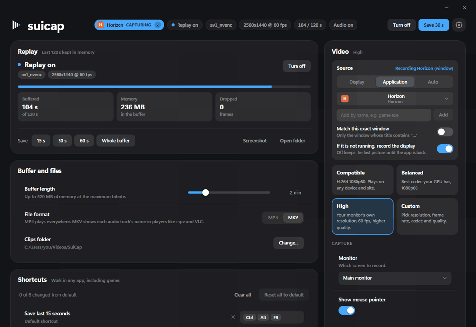
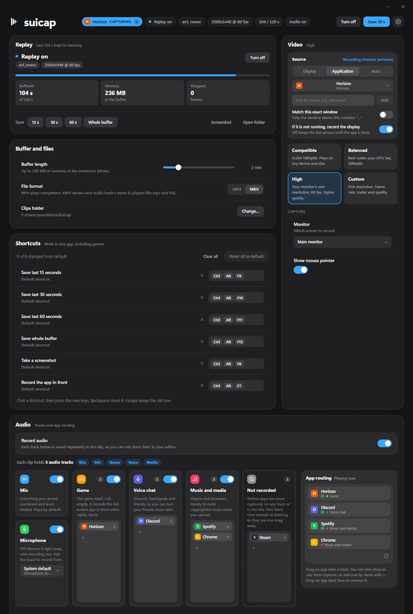
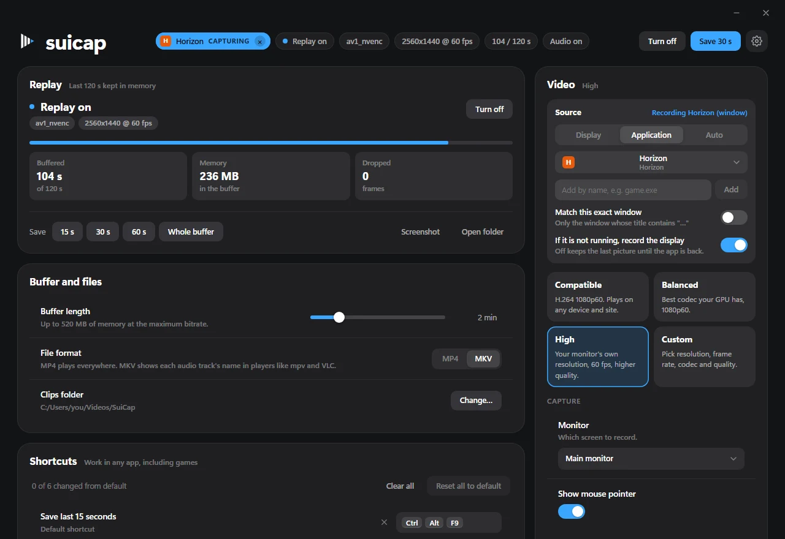
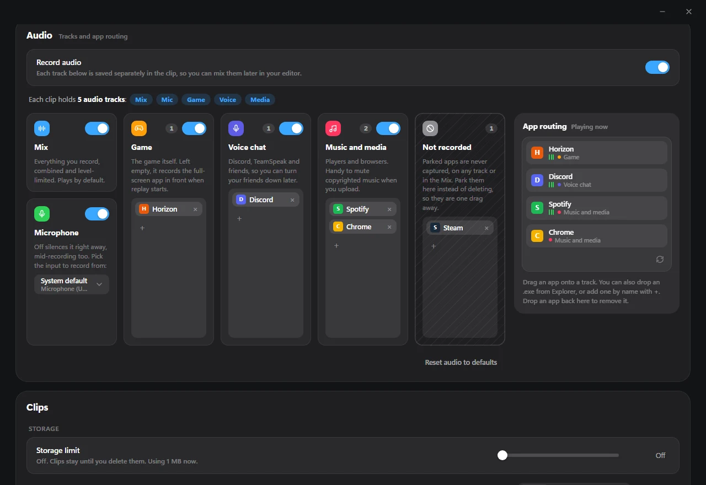
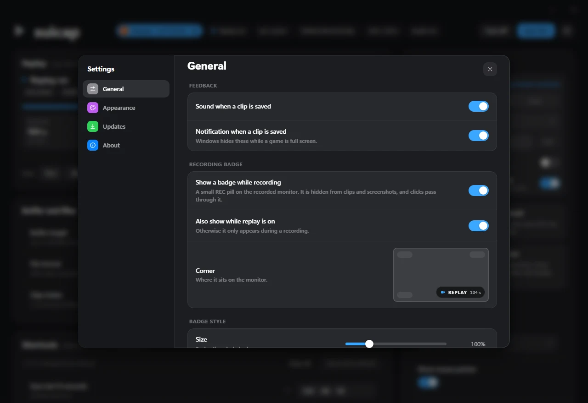

<div align="center">

<picture>
  <source media="(prefers-color-scheme: dark)" srcset="docs/media/suicap-lockup-dark.svg">
  
</picture>

### Never miss the moment. Save it after it happens.

A GPU replay-buffer recorder for Windows, with a separate audio track for every part of your session.




<sub>The dashboard, the audio routing board and the settings window. Mock data, not a real session.</sub>

[**Download**](https://github.com/giran03/SuiCap/releases/latest) · [Features](#-features) · [Quick start](#-quick-start) · [Requirements](#-requirements) · [Build from source](#-build-from-source)

</div>

<br>

> [!NOTE]
> SuiCap uses the Windows screen-capture API. It **injects nothing into your game**, so there is no hook for anti-cheat to flag.

> [!TIP]
> New here? Jump to the [Quick start](#-quick-start). You can be saving clips in under a minute.

## ✨ Features

<table>
<tr>
<td width="50%" valign="top">

### ⏪ Replay buffer & continuous recording
Keep the last 10 seconds to 10 minutes in memory and save with a shortcut after the moment happens — or switch to **Continuous** mode to record straight to disk with gapless auto-splitting by time or file size, pause/resume, idle auto-pause, and disk space protection.

</td>
<td width="50%" valign="top">

### 🎯 Record what you choose
A whole display, one application's window, or **Auto**, which follows the full-screen game. Pick the app from a list, like OBS window capture.

</td>
</tr>
<tr>
<td width="50%" valign="top">

### 🎚️ Audio on separate tracks
Mix, Microphone, Game, Voice chat and Music each get their own track. Mute any of them in the editor later, or before you upload.

</td>
<td width="50%" valign="top">

### ⚡ Hardware encoding
AV1, HEVC or H.264 on your GPU, with the buffer kept as compressed packets so memory stays low.

</td>
</tr>
</table>

| | | |
|---|---|---|
| 🔀 **App routing** <br> Drag a running app onto a track, or park it in "Not recorded" so it never reaches a clip. | 🔇 **Live mute** <br> Switch a track off mid-recording and it goes silent right away, in the Mix too. | 🏷️ **Named tracks** <br> MKV clips name every track in players like mpv and VLC. |
| 🎙️ **Microphone picker** <br> Choose any input, and it follows the device if you unplug and replug it. | 🖼️ **Clip library** <br> Browse, trim, open and delete saved clips and screenshots from the app. | 🔔 **Recording badge** <br> A small badge that is never captured, and says "CLIP SAVED" when you save. |

## 👀 Everything, one glance away

[](docs/media/overview.webp)

### ⏪ Replay, continuous recording, and preview
The top-left panel lets you switch between **Replay** and **Continuous** recording, save recent highlights or manage active segments, and check the live **Preview** card above the Video settings to verify framing and aspect ratio before you hit record. Presets cover most setups, and Custom lets you pick resolution, frame rate, codec and quality.

[](docs/media/dashboard.webp)

### 🎯 Choosing what to record

- **Display:** the whole monitor you pick. This is the default.
- **Application:** pick a window from the list, or type a program name for an app that is not running yet. Add a title to record only one window of that app.
- **Auto:** follows the full-screen game and falls back to the display when there is none.
- **If the app is missing,** SuiCap records the display instead and switches back when the app returns. You can turn that off to hold the last picture instead.
- **Shortcut:** `Ctrl+Alt+F7` switches between the app in front and the whole display.

[](docs/media/audio.webp)

### 🎚️ Audio routing

- **Drag, drop or click:** drag an app onto a track, or open its menu and choose one. Right-click anything for more options.
- **Apps come from your machine:** running programs are detected the way the OS reports them, and apps you have not installed stay hidden.
- **Not recorded:** park apps you never want in a clip, on any track or in the Mix.
- **Strict mute:** an app on a switched-off track is silent everywhere, not only on its own track.

[](docs/media/settings.webp)

### ⚙️ Settings

General, Storage, Appearance, Updates and About live in a window that opens over the dashboard. Choose custom folders for finished clips and temporary recording files, manage retention limits, customize the recording badge, and verify updates against the release checksum before they run.

### ⌨️ Shortcuts

| Action | Default |
|---|---|
| Start or stop continuous recording | `Ctrl+Alt+F6` |
| Save the last 15 / 30 / 60 seconds | `Ctrl+Alt+F9` / `F10` / `F11` |
| Save the whole buffer | `Ctrl+Alt+F12` |
| Take a screenshot | `Ctrl+Alt+F8` |
| Record the app in front, or the display | `Ctrl+Alt+F7` |

Every shortcut can be changed, cleared or reset to its default. They work in any app, including full-screen games.

## 🧰 Made for everyday use

- **Lives in the system tray:** closing the window keeps the buffer running. Quit from the tray menu.
- **Starts with Windows** (optional) and can turn replay on by itself.
- **Recovers on its own** when a display, the GPU driver or the capture source is lost.
- **Keeps clips tidy:** each clip goes into a folder named after the app, and a storage limit can clear the oldest ones.
- **Command line included:** `suicap-cli` records, replays and runs long test sessions without the window.

## 📋 Requirements

- Windows 10 version 2004 or later, or Windows 11 (64-bit)
- A GPU with a hardware video encoder (NVIDIA NVENC, AMD AMF or Intel Quick Sync)
- Microsoft Edge WebView2 (already part of Windows 11)

> [!IMPORTANT]
> A game running **as administrator** can only be recorded if SuiCap runs as administrator too. Some exclusive full-screen games and protected video can show a black picture when recorded as a window. Use the display source for those.

## 📥 Download and install

1. Download the latest installer from the [Releases page](https://github.com/giran03/SuiCap/releases/latest).
2. Run it and follow the prompts.
3. Open SuiCap. It sits in the tray, and the dashboard opens from the tray icon.

## 🚀 Quick start

1. **Turn replay on.** Press **Turn on** at the top of the dashboard.
2. **Pick what to record.** Leave it on **Display**, or choose **Application** and select your game.
3. **Route your audio** (optional). Drag Discord onto **Voice chat** and your music player onto **Music and media**.
4. **Play.** When something good happens, press `Ctrl+Alt+F10` to save the last 30 seconds.
5. **Find the clip.** Open **Clips** on the dashboard, or press **Open folder** on the replay panel.

## 🛠️ Build from source

Needs Rust (stable), [Bun](https://bun.sh) and a Windows GPU with a hardware encoder.

```bash
bun install
.scripts/"SuiCap Fetch FFmpeg.bat"   # once: downloads FFmpeg into vendor/
bun run tauri dev                    # dev app (UI on port 1421)
bun run check                        # UI type check
cargo test -p suicap-core            # core tests
```

| Folder | What is in it |
|---|---|
| `crates/suicap-core` | Capture, encoding, audio, the replay buffer and the muxer |
| `crates/suicap-cli` | The command-line recorder |
| `src-tauri` | The Tauri app: tray, shortcuts, the badge and commands |
| `ui` | The Svelte interface |
| `brand` | The logo and its guidelines |

<br>

---

<div align="center">

<picture>
  <source media="(prefers-color-scheme: dark)" srcset="docs/media/suicap-mark.svg">
  
</picture>

**SuiCap** · Designed and built by **CafeTako Team**

[Download](https://github.com/giran03/SuiCap/releases/latest) · [Changelog](CHANGELOG.md)

</div>
